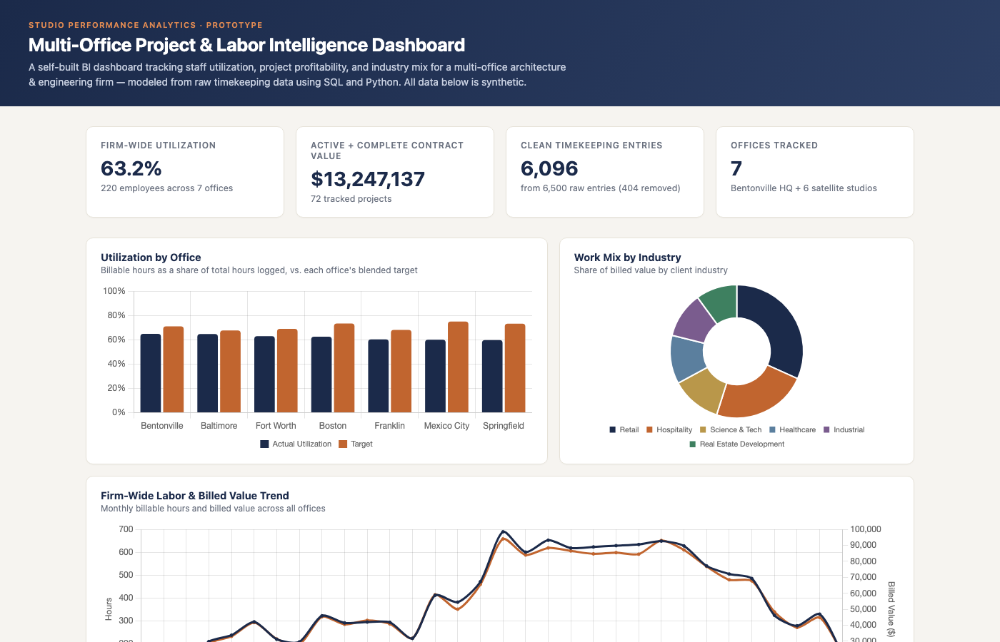

# Studio Performance Analytics

An end-to-end BI project: a Python ETL pipeline cleans raw timekeeping data, SQL models staff utilization and project profitability, and a Chart.js dashboard shows the results.

**[Live demo](https://maxhdodson.github.io/Studio-Performance-Analytics/dashboard/)**



> **All data in this project is simulated.** The firm, clients, employees, projects and hours are generated by `etl/generate_data.py`. Nothing here comes from a real company. The scenario is a made-up 220-employee, 7-office architecture and engineering firm with 72 projects, built to model the timekeeping data a multi-office A&E firm produces.

## Why I built it

At Hedgerow I worked on the reporting side of timekeeping data: cleaning 2,000+ raw records and building Power BI reports for leadership. I wanted to build the upstream part myself too, from schema design through ETL and SQL to the dashboard. This project covers that whole chain on one dataset.

## The problem

Studio leadership needs answers to five questions every month, and the raw
data to answer them arrives messy:

1. Are we staffed efficiently? Which offices are running under or over their
   utilization target?
2. Which projects are profitable, and which are quietly eating their budget?
3. How is our work distributed across industries, and where's the growth?
4. Are we delivering projects on schedule?
5. Which project managers are consistently delivering healthy margins?

The raw timekeeping export has the problems every real timekeeping export
has: inconsistent date formats, hours logged with stray units or extra
whitespace, a handful of negative or impossibly large entries, duplicate
syncs, and a few orphaned records pointing at employees that don't exist in
the roster.

## Approach

```
generate_data.py          synthetic but realistic source data
      |
      v
timekeeping_raw.csv   <-- intentionally messy (see Data Quality below)
offices / employees / clients / projects / rate_card.csv  <-- clean reference data
      |
      v
clean_and_load.py          ETL: parses/validates/dedupes raw timekeeping,
      |                     loads everything into SQLite against 01_schema.sql
      v
studio_analytics.db        relational database (7 tables, indexed)
      |
      v
02_analysis_queries.sql    7 analytical queries answering the 5 questions above
      |                     (re-implemented in Python inside clean_and_load.py
      |                      so the pipeline runs in one command)
      v
dashboard/data.json  -->   build.py embeds it into dashboard/index.html
      |
      v
dashboard/index.html       interactive dashboard (Chart.js), opens standalone
```

`dashboard/index.html` is then a single self-contained file -- open it
directly in a browser (no local server needed).

## Tech stack

- **Python** (standard library) for synthetic data generation and the ETL pipeline
- **SQL (SQLite)** for the schema and all analytical logic: joins, aggregations, variance calculations, and a documented join-fanout fix in the industry-mix query
- **Chart.js** for the charts
- **Vanilla JavaScript** for search, sort and filter, with no framework, so the dashboard is a single portable HTML file

## Data model

Seven tables: `offices`, `industries`, `rate_card`, `clients`, `employees`, `projects`, and the `timekeeping` fact table (one row per labor entry, 6,096 rows after cleaning). `rate_card` holds a simplified cost and billing rate by title, which turns hours into labor cost and billed value. See `sql/01_schema.sql` for the DDL and `sql/02_analysis_queries.sql` for the annotated queries.

## Run it

Requires Python 3. No packages to install.

```bash
cd etl
python3 generate_data.py     # writes ../data/*.csv (simulated source data)
python3 clean_and_load.py    # cleans, loads SQLite, writes ../dashboard/data.json
cd ../dashboard
python3 build.py             # embeds data.json into index.html
```

Then open `dashboard/index.html` in a browser. It loads Chart.js from a CDN, so you need an internet connection.

## Data quality / ETL

Of 6,500 raw timekeeping rows, 404 (6.2%) were removed by the cleaning
pipeline, with every removal reason logged and surfaced on the dashboard
itself:

| Issue | Rows |
|---|---|
| Blank/missing hours | 126 |
| Negative hours (entry error) | 99 |
| Exact duplicate entries (double sync) | 122 |
| Orphaned employee reference | 39 |
| Implausible single-day entry (>16h) | 18 |

Dates arriving in three different formats (`2025-01-14`, `01/14/2025`,
`1/14/25`) are normalized to ISO before loading, and task categories with
inconsistent casing/whitespace are normalized as well.

## What the simulated data shows

- **Utilization varies more across offices than firm-wide averages suggest.**
  Bentonville (HQ) runs highest at 64.9% billable utilization; Springfield
  runs lowest at 59.8% -- a 5-point gap that a single firm-wide number would
  hide entirely.
- **Margin performance is uneven even though no tracked project is
  unprofitable.** Gross margin across projects ranges from ~47% to over 99%,
  and only 3 of 72 projects ran over their budgeted hours -- but those 3
  concentrate almost all of the firm's schedule and cost risk.
- **Retail and hospitality dominate the portfolio** (22 and 18 projects
  respectively, well ahead of healthcare, industrial, real estate
  development, and science/tech), a retail-heavy mix by design of the simulated firm.
- **Schedule slippage is the biggest risk signal in the data**: of 50
  completed projects, 36 finished late (by an average of ~21 days), while 14
  finished on time or early (by an average of 6 days ahead). That's a
  clearer leading indicator than budget variance alone.
- **Project manager performance varies widely** even among PMs with similar
  project counts, which the PM performance table on the dashboard surfaces
  directly rather than burying in a firm-wide average.

## Hardest problem

_To be written by Max: the hardest problem you hit building this (for example a duplicate rule or a join that double-counted), what you tried, and how you fixed it. The industry-mix query in `sql/02_analysis_queries.sql` documents one join-fanout fix as a starting point._

## What I'd build next

- Project-phase budgets (schematic design, design development, construction documents, construction administration) instead of one whole-project budget
- A forecast-at-completion metric that projects burn rate against remaining scope
- The same data model rebuilt as a Power BI report with DAX measures

## Repository layout

```
README.md
LICENSE
docs/                         dashboard screenshots
sql/01_schema.sql             relational schema
sql/02_analysis_queries.sql   annotated analytical queries
etl/generate_data.py          simulated data generator
etl/clean_and_load.py         cleaning pipeline, SQLite load, JSON export
data/                         generated CSVs and studio_analytics.db
dashboard/build.py            embeds data.json into a standalone index.html
dashboard/index.html          the dashboard
```

## License

MIT. See [LICENSE](LICENSE).
